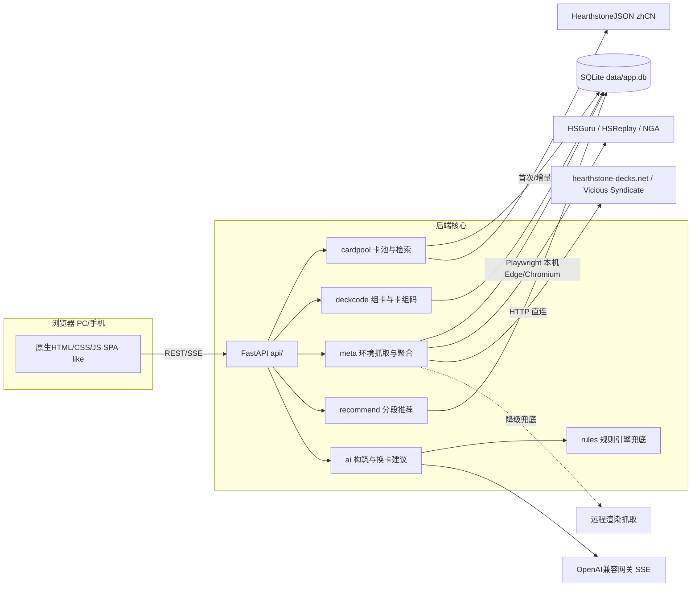

## 产品概述

《炉石卡组构筑器》——一个本机运行的Web工具：自动汇总天梯各分段环境数据，按分段推荐强势卡组，支持官方卡组码导入导出与手动组卡，并能用 AI 一键自动构筑、按用户意图给出换卡建议。电脑端和同 WiFi 的手机端浏览器均可直接访问。

## 核心功能

1. **多端访问**：同一 Web 页面自适应 PC 宽屏与手机竖屏（PC 三栏工作区，手机底部 Tab 切换 + 半屏抽屉）。
2. **卡池与组卡**：中文卡池（职业/费用/品质/关键词/系列/文本搜索）；标准/狂野模式切换；30 张上限、传说限 1 张、死亡骑士符文等合法性校验；法力曲线、合成尘数统计；官方卡组码（AAECA...）双向导入导出。
3. **环境数据获取**：多源 Provider 机制抓取天梯各分段环境（HSReplay、驴子网 HSGuru、NGA 优先；被拦截时自动降级到 hearthstone-decks.net、Vicious Syndicate 等可达源），统一归一化、去重加权、生成环境快照；抓取失败时回落到上一次成功快照并在界面标注数据时间。
4. **分段推荐**：按分段（前千传说/传说/钻石~传说5/黄金~铂金/青铜~白银/休闲，可配置）输出卡组榜，展示胜率、样本量、环境占比、趋势、适用提示，支持一键载入组卡器。
5. **AI 构筑与换卡建议**：输入职业、模式、风格、目标分段（可选已拥有卡牌），AI 流式产出 30 张卡组 + 构筑思路 + 起手留牌；选中某张卡并提出意图（如"更快""更便宜""针对快攻"），AI 结合实时卡池与当前环境给出候选替换卡、理由、尘数与影响说明，一键替换。
6. **界面气质**：简洁明快、中文友好、操作反馈明确；模型不可用时自动降级为规则引擎建议，不阻塞流程。

## 技术栈选型

- **后端**：Python 3.13（`py -3.13`，系统默认 python 3.8 不可用于新版 FastAPI）+ FastAPI + Uvicorn，单进程 `--host 0.0.0.0 --port 8765`（本机 8899 已被其他项目占用）。
- **存储**：SQLite（WAL 模式）卡池表 + 环境快照表 + 缓存表；原始数据文件缓存到 `data/`。
- **抓取**：HTTPX（可达源）+ Playwright 驱动本机 Edge/Chromium（被 Cloudflare 拦截的源）；失败时远程渲染源兜底。
- **AI**：OpenAI 兼容协议客户端（SSE 流式），书接既有网关 `https://api.hcnsec.cn/v1`，凭证仅从环境变量/本地 `.env` 读取（`.env` 入 `.gitignore`，计划与代码只写占位符）。
- **前端**：零构建的原生 HTML + CSS + ES Module JS，由 FastAPI 以 Jinja2 模板托管静态资源（无 npm 运行时依赖，手机端直接访问同一端口）。
- **测试**：pytest（卡组码往返、过滤器、聚合、推荐、AI 解析，LLM 用 mock）+ Playwright（PC/手机视口端到端冒烟）。

## 实现方案

**总体策略**：分层为「卡池层 → 卡组层 → 环境层 → 推荐层 → AI 层 → 表现层」，每层通过 FastAPI JSON API 暴露，前端只消费 API，保证后续换前端也不动后端。

**关键技术决策**（均已实测确证）

1. **卡池源**：`https://api.hearthstonejson.com/v1/latest/zhCN/cards.collectible.json`（实测 200，全量 cards.json 10.2MB / 36390 条，其中 collectible=true 仅 8328 条），首次拉取后按 dbfId 增量入库；需剔除 HERO_SKINS(790)、CORE_HIDDEN、MANA_DARKMOON/TS/TB/TBC_* 等非构筑系列。该目录**不存在 sets.json / standard.json / latestStandard/**，故标准/狂野轮换以项目内可编辑配置 `config/sets.yaml` 维护（并在 README 标注更新日期）。
2. **卡牌图片默认不加载**：改用本地文字渲染卡面（成本/费用/身材/卡面文字），确保断网与 CDN 不可达时界面完整、首屏快；图片仅在可配置开关下异步加载并设置兜底。
3. **环境抓取使用洋葱式降级链**：① 本地 Playwright 真实浏览器内核取 HSGuru/HSReplay/NGA（先读 robots.txt 遵守规则）→ ② 仍被 WAF 拒绝则调用远程渲染抓取兜底 → ③ 再降级 HTTP 直连 hearthstone-decks.net / Vicious Syndicate 文本解析 → ④ 全部失败则用 SQLite 中上一次快照并在前端显示数据源健康状态与数据时间。抓取为异步任务，单飞互斥，每源超时 30s、总上限 120s。
4. **卡组码**：自行实现 DBF varint + base64 编解码（不引第三方），并用真实官方卡组码做往返单元测试。
5. **AI 交互**：统一走 SSE 流式（该网关长文本响应 200-330s，非流式会长时间挂起）；**必须显式指定模型**（`model=auto` 会被路由到只输出 reasoning_content 的推理模型导致 content 为空），配置主模型 + 回退链 + 超时重试。
6. **AI 输出可控性**：不让模型自由输出卡名后直接采信——"本地召回候选 Top-N（按同费用/同职业/关键词相近/环境高频）→ 模型排序并写理由 → 本地二次校验（卡名存在、传说限制、30 张、尘数、玩家是否拥有）→ 非法自动剔除重试"，这样即使模型胡说也不会污染卡组。
7. **性能**：8328 张卡的列表用虚拟滚动 + 搜索 250ms 防抖 + SQLite 索引（name、cardClass+cost、set）；推荐榜与环境统计在写入快照时预聚合，读接口只做内存/单表查询，避免每次请求重新计算；AI 请求体只携带精简候选（名称/费用/简述，控制在 ~40-60 张）降低 token 与时延。

## 执行要点（防踩坑）

- **PowerShell 5.1**：所有 `.ps1` 脚本必须 UTF-8 **带 BOM** 落盘，并在脚本头设置 `[Console]::OutputEncoding` 与 `$OutputEncoding` 为 UTF-8，否则中文命令被当字符串回显。
- **编码**：服务入口固定 `PYTHONIOENCODING=utf-8`（入口 `sys.stdout.reconfigure(utf-8, errors="replace")`），避免日志重定向到文件/管道时中文/符号触发 UnicodeEncodeError 直接崩服。
- **启动**：必须用 `py -3.13` 的虚拟环境；`run.bat` 负责建 `.venv`、装依赖、打印局域网 IP 与访问地址（供手机扫码/直连）。
- **密钥安全**：`.env`、`.venv/`、`data/` 快照必须进 `.gitignore`；日志禁止打印模型和 token，只记录模型名与耗时。
- **blast radius**：抓取器对外部站点限速（并发≤2、间隔≥1s）、只读不写；任何源失败不影响其它源与整体服务；新增 Provider 只实现抽象基类，不改聚合逻辑。

## 架构设计



## 目录结构

```
d:/ai/lsgzq/
├── requirements.txt                      # [NEW] 锁定版本：fastapi, uvicorn, httpx, pydantic-settings, jinja2, pytest, playwright
├── run.bat / start.ps1                   # [NEW] 建 .venv(py -3.13)、装依赖、UTF-8 环境、启动 0.0.0.0:8765 并打印局域网IP
├── .env.example                          # [NEW] 占位：LLM_BASE_URL/LLM_API_KEY/LLM_MODEL/LLM_MODEL_FALLBACKS
├── .gitignore                            # [NEW] 忽略 .env/.venv/data/__pycache__
├── README.md                             # [NEW] 安装、启动、手机访问、数据源说明与标准系列维护方法
├── config/
│   ├── app.yaml                          # [NEW] 端口、缓存时长、刷新策略、分段档位定义、AI 模型与回退链
│   └── sets.yaml                         # [NEW] 标准/狂野系列清单（唯一轮换口径，手维护并标注日期）
├── server/
│   ├── main.py                           # [NEW] 应用装配、生命周期、UTF-8 兜底、静态/页面路由、健康检查
│   ├── settings.py                       # [NEW] pydantic-settings 读取 config 与环境变量（含防火墙端口、AI 凭证占位）
│   ├── logging_conf.py                   # [NEW] 统一日志；禁止输出 token
│   ├── db/{base.py,models.py}            # [NEW] SQLite 连接(WAL)、迁移初始化、表：cards/meta_entry/snapshot/refresh_log/cache
│   ├── cardpool/{fetcher.py,normalizer.py,service.py}
│   │                                     # [NEW] 拉取(ETag增量)/清洗过滤/建索引/查询API(职业·费用·稀有度·关键词·系列·文本)
│   ├── deckcode/{codec.py,validate.py}   # [NEW] 卡组码 varint+base64 编解码；30张/传说1/符文/职业校验、曲线、尘数
│   ├── meta/
│   │   ├── schemas.py                    # [NEW] MetaEntry/Snapshot 归一化数据结构
│   │   ├── base.py                       # [NEW] MetaProvider 抽象基类（fetch→List[MetaEntry]）
│   │   ├── browser.py                    # [NEW] Playwright 上下文(本机Edge/Chromium)、限速、robots 合规、健康检查
│   │   ├── providers/{hsguru.py,hsreplay.py,nga.py,hearthstone_decks.py,vs_report.py,remote_render.py}
│   │   │                                 # [NEW] 各源实现；前三个走浏览器内核，后三个走HTTP/远程兜底
│   │   ├── aggregator.py                 # [NEW] 多源合并、卡表签名去重、加权、置信度打分
│   │   └── scheduler.py                  # [NEW] 异步单飞刷新、源健康状态、快照落库与陈旧标记
│   ├── recommend/engine.py               # [NEW] 按分段分档排序推荐（胜率/样本/占比/趋势/适用理由）
│   ├── ai/
│   │   ├── client.py                     # [NEW] OpenAI 兼容 SSE 客户端，显式模型+回退链+超时重试
│   │   ├── prompts.py                    # [NEW] 构筑/换卡/评价三类提示词模板（注入精简环境与卡池上下文）
│   │   ├── builder.py                    # [NEW] 自动构筑：生成→解析→本地校验→修复重试
│   │   ├── swap.py                       # [NEW] 换卡建议：本地召回→模型排序→本地二次校验
│   │   └── rules.py                      # [NEW] 规则引擎兜底（曲线/费用/关键词/针对性）
│   └── api/{cards.py,decks.py,meta.py,recommend.py,ai.py,health.py}
│                                         # [NEW] REST 接口 + /api/ai/*/stream(SSE)
├── web/
│   ├── templates/index.html              # [NEW] 单页骨架（顶栏 + 三栏/移动端底部Tab + 抽屉）
│   ├── static/css/{theme.css,builder.css,meta.css}
│   │                                     # [NEW] 设计变量、卡牌/卡组区、环境推荐区样式与微动画
│   └── static/js/{app.js,api.js,cards.js,deck.js,meta.js,ai.js}
│                                         # [NEW] 路由状态、接口封装、虚拟滚动筛选、卡组编辑与卡组码、分段推荐、SSE建议
├── tests/
│   ├── test_deckcode.py                  # [NEW] 官方卡组码往返与异常输入
│   ├── test_cardpool.py                  # [NEW] 过滤/搜索/模式切换
│   ├── test_meta_aggregator.py           # [NEW] 多源合并去重与置信度
│   ├── test_recommend.py                 # [NEW] 分段推荐排序与边界（无数据/样本不足）
│   ├── test_ai_swap.py                   # [NEW] mock LLM：非法卡名剔除、重试、规则兜底
│   └── smoke.ps1                         # [NEW] 端到端冒烟（含手机 UA 请求首页）
└── data/                                 # [NEW] app.db、cards 缓存、meta 快照（入 .gitignore）
```

## 关键代码结构

```python
# server/meta/schemas.py —— 各数据源归一化后的统一结构（聚合层唯一依赖）
@dataclass(frozen=True)
class MetaEntry:
    deck_name: str          # 卡组/体系名（中文优先）
    card_class: str         # MAGE|DRUID|... 归一化英文枚举
    archetype: str          # Aggro|Control|Combo|Midrange|Tempo
    rank_bucket: str        # TOP1000_LEGEND|LEGEND|DIAMOND_TO_L5|GOLD_TO_PLATINUM|BRONZE_TO_SILVER|CASUAL
    win_rate: float | None  # 0-1
    sample_size: int | None
    share: float | None     # 环境占比 0-1
    trend: float | None     # 环比变化
    deck_code: str | None   # 官方卡组码，用于去重与一键载入
    cards_signature: str    # 卡表排序后的哈希（无卡组码时的去重键）
    source: str             # hsguru|hsreplay|nga|hearthstone_decks|vs_report
    fetched_at: datetime
    confidence: float = 0.0 # 由样本量/来源权重/新鲜度计算

# server/meta/base.py —— Provider 抽象基类（新源只实现 fetch，不改聚合逻辑）
class MetaProvider(abc.ABC):
    name: str
    enabled: bool
    @abc.abstractmethod
    async def fetch(self, *, mode: str, since_days: int) -> list[MetaEntry]: ...
    async def healthcheck(self) -> tuple[bool, str]: ...  # 返回可用性+原因，用于前端展示源健康状态
```

```python
# server/ai/swap.py —— 换卡建议的主流程签名（保证输出可控）
async def suggest_swaps(deck_code: str, target_card: str, intent: str,
                        mode: str, owned: set[int] | None) -> SwapSuggestion:
    # 1) 本地召回 candidates（同/相邻费用、职业合法、KEYWORD相近、环境高频）→ top 60
    # 2) 仅把 candidate 精简字段送 SSE 模型排序并生成理由
    # 3) validate_deck 二次校验：卡名存在、传说上限1、总数30、尘数、拥有情况
    # 4) 非法条目丢弃，不足则重试一次；连续失败 → rules.suggest_swaps 兜底
```

## 设计说明

采用「原生 HTML + CSS + ES Module JS」零构建栈，由 FastAPI 单进程托管，手机在同一 WiFi 用电脑 IP 直开即用；不引入组件库，改用自研 CSS 设计变量体系（卡片投影、全息描边、微动效），既保证界面精致又避免打包链路带来的额外故障点。

## 设计风格

炉石幻想做减法：深色石板/墨蓝底 + 琥珀金高光 + 卡牌羊皮纸局部质感；圆角卡牌、柔和投影、悬停微抬； pencils 微动画（筛选展开、卡片入组弹入、SSE 文字逐字流式、切换分段淡切）；整体轻松明快不压抑，按钮大而明确、反馈即时。

## 页面规划（3 个主视图，互为一键流转）

### 1. 环境推荐页（默认首页）

- 顶栏：产品名 + 模式（标准/狂野）切换 + 分段下拉 + 刷新按钮（显示数据时间/源健康）。
- 环境概览条：本分段职业热度与梯队摘要，横向卡片滚动。
- 推荐卡组榜：按胜率排序的卡组卡（体系名/两张代表卡/胜率/样本/占比/趋势/一句适用理由），点击展开详情。
- 一键操作区：载入组卡器、交给 AI 优化、复制链接；无数据时展示源健康状态与「使用上次快照」提示按钮，可直接跳转折叠 GV。

### 2. 组卡器页

- 筛选栏：职业、费用滑块（法力石样式）、品质、关键词、系列、中文搜索框。
- 卡池列表：两列/三列响应式网格 + 虚拟滚动，文字卡面、右键/长按快捷加入。
- 当前卡组：右侧竖排卡表（点击移除），法力曲线柱状图、总尘数、合法性进度条与提示。
- 底部操作条：复制/粘贴卡组码导入、导出、保存本地、AI 一键构筑入口。

### 3. AI 建议面板（右侧抽屉 / 手机半屏抽屉）

- 意图输入：预设标签（更快/更稳/更便宜/针对快攻/针对控制）+ 自定义文本。
- 自动构筑结果：流式输出 30 张卡预览 + 构筑思路 + 起手留牌 + 一键采纳。
- 换卡建议：选中卡高亮，候选替换卡列表（名称/费用/尘数变化/理由/替换后胜率预期语义描述），一键替换或撤销。

### 移动端

底部 Tab 三页切换（环境 / 组卡 / 我的卡组），卡片与按钮加大触控区，卡池采用单列大卡、横向筛选芯片，AI 结果用半屏抽屉流式渲染。

## Agent Extensions

### Skill

- **frontend-design**
- Purpose：产出上述三视图的高质量 UI 实现（卡牌质感、抽屉面板、法力曲线可视化），避免模板化观感
- Expected outcome：静态资源（theme/builder/meta CSS + JS）达到可直接验收的成品级质感
- **ui-ux-pro-max**
- Purpose：校验移动端可用性与设计一致性（触控区、对比度、空态与错误态、信息层级）
- Expected outcome：PC/手机两端断点与宫格规范统一，空态、失败降级态均有明确文案与出口
- **playwright-cli**
- Purpose：①实测本机 Edge/Chromium 能否绕过 Cloudflare 抓取 HSGuru/HSReplay/NGA；②PC 与手机视口的端到端冒烟与截图核验
- Expected outcome：产出抓取可行性结论（决定降级链），并验证核心交互（搜索选卡、组卡、导入导出卡组码、AI 建议流式展示）真实可用

### MCP

- **Firecrawl MCP Server**
- Purpose：作为本地浏览器仍被拦截时的远程渲染兜底源，抓取 HSReplay/HSGuru/NGA 元 somehow 环境页并转成结构化内容；开发期也用于快速采样真实页面结构以编写解析规则
- Expected outcome：得到可入库的真实分段环境样例数据（含卡组名/胜率/样本/卡组码），失败时明确给出不可达结论以触发次级降级