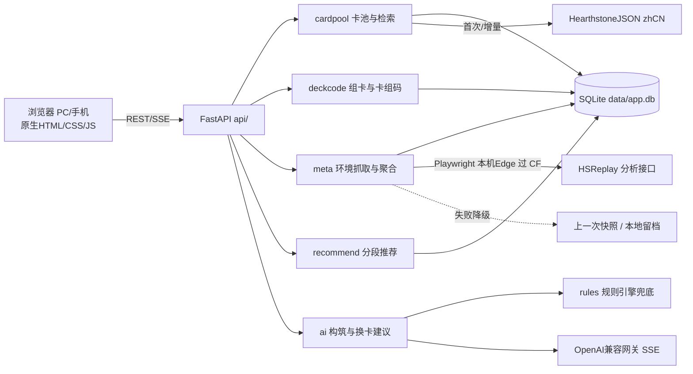

# 《炉石卡组构筑器》设计文档

> 项目路径：`d:/ai/lsgzq`　|　文档版本：v1.1　|　更新日期：2026-11-02　|　状态：**8 个阶段全部交付**

---

## 一、产品定位

一个运行在本机的 Web 工具：自动汇总天梯各分段环境数据，按分段推荐强势卡组，支持官方卡组码导入导出与手动组卡，并能用 AI 一键自动构筑、按用户意图给出换卡建议。电脑和同 WiFi 的手机浏览器都能直接访问。

**目标用户**：炉石传说休闲到竞技玩家，想要「选一个适合自己的强势卡组 → 按自己的牌库微调」。

---

## 二、需求映射

| 需求 | 实现方式 |
|---|---|
| 1. 电脑端 + 手机端可用 | FastAPI 单进程托管响应式页面，`--host 0.0.0.0 --port 8765`，手机同 WiFi 访问电脑局域网 IP；PC 三栏工作区，手机底部 Tab + 半屏抽屉 |
| 2. 爬取各分段环境信息 | 实测后收敛为**单主源**：真实浏览器内核抓 HSReplay 分析接口（免费档位只有青铜~黄金，时间窗只有当前版本/近30天）；HSGuru / NGA 本机网络不可达，按用户决定停用，Provider 位保留。归一化聚合后入快照 + 本地留档降级 |
| 3. 针对不同分段推荐卡组 | 受免费额度限制，改为「时间窗切分 + 节奏风格推断适配分段」：快攻→青铜~白银/黄金~铂金，中速→黄金~铂金/钻石~传说，控制→钻石~传说/传说，组合技→传说/前千传说，胜率≥55% 再上一档；排序用贝叶斯收缩胜率 + 多样性 |
| 4. AI 自动构筑 + 换卡建议 | SSE 流式 AI：输入职业/模式/风格/目标分段生成 30 张卡组；选中某张卡并提意图（更快/更便宜/针对快攻…），本地卡池召回候选 → 模型排序写理由 → 本地二次校验 → 一键替换 |
| 5. 界面简洁明快 | 炉石幻想做减法：深色石板 + 琥珀金高光 + 羊皮纸局部质感，圆角卡牌、柔和投影、微动效；触控区放大、反馈即时 |

---

## 三、技术栈

| 层 | 选型 | 理由 |
|---|---|---|
| 后端 | Python 3.13（`py -3.13`）+ FastAPI + Uvicorn | 系统默认 `python` 是 3.8，跑不动新版 FastAPI |
| 存储 | SQLite（WAL），表：`cards` / `meta_entry` / `snapshot` / `refresh_log` / `cache` | 零运维，单文件，手机多端共享同一数据源 |
| 抓取 | Playwright 驱动本机 Edge/Chromium（页面内 fetch 取接口 JSON）+ HTTPX（可达源） | HSReplay 直连 403，必须过 Cloudflare；接口本身免费开放 |
| AI | OpenAI 兼容协议 SSE 客户端，网关 `https://api.hcnsec.cn/v1` | 凭证仅从环境变量/本地 `.env` 读取，不入库不打印 |
| 前端 | 原生 HTML + CSS + ES Module JS（零构建） | 无 npm 运行时依赖，手机直开即用，避免打包链路故障点 |
| 测试 | pytest（LLM 用 mock）+ Playwright（PC/手机视口冒烟） | 分层可测，冒烟覆盖真实交互 |

---

## 四、架构设计



分层原则：卡池层 → 卡组层 → 环境层 → 推荐层 → AI 层 → 表现层，每层通过 JSON API 暴露，前端只消费 API，换前端不动后端。

---

## 五、数据源（均已实测）

| 数据源 | 状态 | 用途 |
|---|---|---|
| `api.hearthstonejson.com/v1/latest/zhCN/cards.collectible.json` | ✅ 200 | 中文卡池主源（build 255790，collectible 8328 条） |
| `hs.blizzard.cn/deckbuilder/` | ✅ 200 | 交互与布局参考 |
| `hearthstone-decks.net` | ✅ 200 | 校准轮换用的真实卡组样本（不做运行时抓取） |
| `hsreplay.net/analytics/query/*` | ✅ 200（真实浏览器内核） | **环境数据主源**：卡组胜率/样本/完整卡表 |
| `hsreplay.net/api/v1/archetypes/` | ✅ 200 | 卡组原型字典（778 条） |
| `hsreplay.net/api/v1/constructed/meta_period/latest/` | ✅ 200 | 当前补丁与版本周期 |
| `vicioussyndicate.com` | ✅ 200 | 降级源：周报文本 |
| HSReplay（页面） | ⚠️ 直连 403，**真实浏览器内核 200** | 必须走本机 Edge/Chrome 内核 |
| HSGuru / NGA | ❌ 浏览器内核也不可达 | 2026-10-28 实测：超时 / 重定向中断，按用户决定停用 |
| `api.hearthstonejson.com/.../sets.json` | ❌ 不存在 | **无官方轮换接口** → 标准系列清单用 `config/sets.yaml` 手工维护 |
| `api.hearthstonejson.com/v1/latest/zhCN/cards.json`（完整版） | ✅ 200 | **衍生牌（token）表**：官方卡组码会夹带组卡型卡牌的配件（如 TIME_020t1），collectible 版没有，缺了会误报"卡牌不存在" |

### 5.1 标准轮换清单的校准方法（2026-10-28 实测）

官方不提供轮换接口，因此不依赖记忆下单，而是用**真实一手数据反推**：

1. 抓 hearthstone-decks.net 上最近几天发布、标注为 **Standard** 的传说卡组；
2. 用本地卡组码解析器还原 30 张卡，**统计所用系列**；
3. 只在这些卡组里出现的系列 → 当前标准；已在旧卡组出现但近期绝迹 → 已退环境。

| 样本 | 发布时间 | 所用系列 |
|---|---|---|
| Raza Demon Hunter #1 | 2026-10-23 | CORE / TIME_TRAVEL / CATACLYSM / EMERALD_DREAM / THE_LOST_CITY / ESCAPEFROM_VIOLET_HOLD / BE / EVENT |
| Egg Priest #38 | 2026-10-25 | ESCAPEFROM_VIOLET_HOLD / THE_LOST_CITY / BE / CORE / EMERALD_DREAM / TIME_TRAVEL / CATACLYSM |
| Pure Paladin #150 | 2026-10-26 | TIME_TRAVEL / ESCAPEFROM_VIOLET_HOLD / BE / CORE / EMERALD_DREAM / CATACLYSM |
| Cycle Rogue #60（对照） | 2025-01 | WHIZBANGS_WORKSHOP / SPACE / TITANS / CORE_HIDDEN / BATTLE_OF_THE_BANDS / WILD_WEST / ISLAND_VACATION |

结论：当前标准 = CORE + CORE_HIDDEN + CATACLYSM + ESCAPEFROM_VIOLET_HOLD + BE + TIME_TRAVEL + EMERALD_DREAM + THE_LOST_CITY + EVENT。
`SPACE / ISLAND_VACATION / WONDERS / WHIZBANGS_WORKSHOP / WILD_WEST / BATTLE_OF_THE_BANDS / TITANS` 均已退环境。
以上已固化为回归测试 `tests/test_real_decks.py`（默认跳过，需真实卡池），
并已由用户用游戏内截图二次确认：黑暗帝国 / 紫罗兰监狱 / 大地的裂变 / 时间流 / 安戈洛龟途 / 翡翠梦境。

### 5.2 阶段⑤ 环境数据源实测结论（2026-10-28）

用真实浏览器内核（本机 Edge，Playwright 同步 API）探活结果：

| 源 | 结果 | 说明 |
|---|---|---|
| HSReplay | ✅ | 页面 200；`/analytics/query/list_decks_by_win_rate_v2/` 免费返回 **351 套（当前版本）/ 959 套（近30天）**真实卡组：胜率、对局数、完整卡表、原型 id、场均时长 |
| HSGuru 驴子网 | ❌ | 浏览器内核同样 `ERR_CONNECTION_TIMED_OUT`，属网络层不可达，非 WAF |
| NGA | ❌ | 重定向链中断（`chrome-error`），不可用 |

**免费额度边界（逐个参数实测 403/400 验证）**：
`LeagueRankRange` 仅 `BRONZE_THROUGH_GOLD` 免费（传说/钻石档 403 会员）；
`TimeRange` 仅 `CURRENT_EXPANSION`、`LAST_30_DAYS` 免费；`Region` 仅 `ALL` 免费。

因此**分段推荐**改为（用户拍板）：时间窗切分（当前版本 / 近30天）+ 卡组节奏风格推断适配段位
（快攻→青铜~白银/黄金~铂金，中速→黄金~铂金/钻石~传说，控制→钻石~传说/传说，
组合技→传说/前千传说；胜率 ≥55% 再向上一档）。

数据流：`browser（过 CF）→ provider 取 JSON → normalizer 聚合（英译中、风格、卡组码）→ 快照入库 + 本地留档`
任一步失败降级到上一次留档，界面标注「降级显示本地留档」。

### 5.3 阶段⑥ 推荐排序引擎

不直接按胜率排：小样本高胜率噪声大。排序分 = **贝叶斯收缩胜率**
`(胜率×样本 + 环境均值×K) / (样本 + K)`（K 默认 500，样本越大越接近真实胜率）
+ 趋势加分（±0.6）+ 强势胜率加分（≥55% +0.3），再做**职业多样性贪心**（同职业最多 2 套），
并跳过没有可用卡组码的条目。每条推荐带一句中文理由（胜率/样本/节奏/适配分段/环比涨跌/数据来源）。

界面：环境页顶部「推荐上分」榜（按时间窗 + 分段联动），一键导入组卡器后自动切到组卡视图。
冒烟已验证闭环：点推荐榜第一条 → 组卡器显示 30/30。

### 5.4 阶段⑦ AI 教练

**模型实测（2026-10-28，OpenAI 兼容网关）**

| 模型 | 首响应 | 30 张卡组 JSON | 结论 |
|---|---|---|---|
| `step-5-preview` | >90s 无首 token | — | 重推理模型，**不可用**（会假死） |
| `MiMo-V2.6-Flash` | 1.8s | **一次通过本地校验**（30 张 / 尘 3180 / 卡组码合法） | 默认主模型 |
| `Qwen3.8-27B` | 1.1s（短提示词） | 长提示词下连接被重置 | 一级兜底 |
| `DeepSeek-V4.1-Flash` | 5.4s | 网关 502 | 二级兜底 |

对应实现：`server/ai/client.py` 按 `model_chain` 逐级降级；首包超时/连接错误/空 content 都算失败，
自动换下一个模型；部分模型把正文放在 `reasoning_content`，content 为空时回退取该字段。

**不信任模型输出**——所有输出都在本地重新校验：
1. 候选卡池：优先取当前环境快照里该职业真实在用的卡（带“环境热度 N 套”提示），不够再按曲线补齐，
   默认 120 张（提示词约 6k 字符），既控 token 又降低模型跑偏概率；
2. 输出必须是 JSON，卡名要一字不差命中卡池（防编造卡名/英文/旧译名）；
3. 校验失败 → 把**具体错误**（哪些卡名不在池、张数差多少、传说超限）回喂模型重试，最多 2 次；
4. 仍失败 → `server/ai/rules.py` 规则兜底（按曲线配比从环境热度高的卡里凑 30 张），
   并在结果里标注 `source=rules`、`llm_error=原因`，界面如实告诉用户这是兜底。

**接口**（全部 SSE，网关长响应可达 200-330 秒，非流式必超时）：
`GET /api/ai/build`（自动构筑）、`/api/ai/swap`（换卡，每个方案都验证换后仍是合法 30 张）、
`/api/ai/review`（流式点评）、`/api/ai/status`（配置与意图清单）。

实测闭环：AI 自动构筑 50.9s 产出 30 张合法卡组码 → 点「采纳这套卡组」→ 组卡器 30/30；
换卡建议 21.9s 给出 3 条带理由的方案。

### 5.5 阶段⑧ 端到端收尾

**一键启动**（`run.py` / 双击 `run.bat`）
建 `.venv` → 装依赖（用 `requirements.txt` 的内容哈希做标记，改依赖自动重装，未改动直接跳过）→
打印本机 + 局域网地址 → 等服务 `/api/health` 就绪后自动打开浏览器（`DECKFORGE_NO_BROWSER=1` 可关）→
缺 `.env` 时提示 AI 将走规则兜底。

**移动端 AI 抽屉**
≤900px 时抽屉变底部弹层（82vh、圆角、避开 iOS 安全区），输出区 34vh 内滚，
操作按钮按 `flex: 1 1 auto` 自动换行；390px 宽实测无横向溢出，四个按钮均可见。

**收尾时改掉的三个真问题**
1. `analyze()` 的 `curve` 是**按费用下标的列表**（`[0费张数, 1费张数, …]`），不是 dict，
   `stats_block` / `curve_issues` 按 dict 取值会 `IndexError`，点「AI 优化」必崩——已修并加了针对列表形态的回归测试；
2. `.stream-box` 没设 `white-space: pre-wrap`，AI 输出里的换行全被折叠成一行；
3. 组卡面板的「AI 优化」按钮此前没绑任何事件，点了没反应——现为「开抽屉 + 流式点评当前卡组」。

**回归基线**：单测 46 通过（隔离卡池）+ 真实卡池 9 通过；
UI 冒烟全绿（环境 60 卡 / 推荐 8 条 / AI 采纳 30/30 / 手机抽屉 chips 6 项全宽无溢出 / 控制台错误 0），
截图落在 `data/shots/`。

---

## 六、关键设计决策

1. **卡池清洗**：剔除 `HERO_SKINS`(790 条)、`TB_*`/`TBC_*` 等非构筑系列。**注意 `CORE_HIDDEN` 不能整体剔除**——其中 654 张标记为 collectible，部分（如「暗影步」）是当前唯一可用版本；改为按卡名去重（优先保留标准版本）。
2. **卡面默认文字渲染**：不加载 CDN 图片（成本/身材/卡面文字本地渲染），保证断网和 CDN 不可达时界面完整、首屏快。
3. **洋葱式降级链**：① 本地 Playwright → ② 远程渲染兜底 → ③ HTTP 直连可达源 → ④ 上一次快照 + 前端标注数据时间与源健康状态。异步单飞刷新，单源超时 30s、总上限 120s。
4. **卡组码自研实现**：DBF varint + base64，不引第三方库，用真实官方卡组码做往返单测。
5. **AI 必须流式 + 显式指定模型**：网关长文本响应 200-330s，非流式会长时间挂起；`model=auto` 会被路由到只输出 `reasoning_content` 的推理模型导致 `content` 为空。
6. **AI 输出可控**：本地召回候选 Top-N → 模型排序写理由 → 本地二次校验（卡名存在/传说限 1/总数 30/尘数/拥有情况）→ 非法剔除重试 → 连续失败降级规则引擎。模型胡说也不会污染卡组。
7. **性能**：虚拟滚动 + 搜索 250ms 防抖 + SQLite 索引（name、cardClass+cost、set）；推荐榜写入快照时预聚合；AI 请求体只带精简候选（~40-60 张）降 token 与时延。

---

## 七、设计系统

**色彩**

| 角色 | 色值 |
|---|---|
| 主色（琥珀金） | `#F2B13C` / 亮 `#FFD479` / 暗 `#C77B2A` |
| 背景（深色石板） | `#141A24` / `#1B2330` / `#232D3D` |
| 文字 | `#F5F1E8` / `#B9C2D0` / `#7C8798` |
| 功能色 | 成功 `#4CAD6E` / 警告 `#E8A33D` / 危险 `#D9534F` / 信息 `#6FB1FC` |

**字体**：PingFang SC；标题 28px/700，副标题 18px/600，正文 14px/400。

**质感与动效**：圆角卡牌、柔和投影、卡片全息描边、悬停微抬；筛选展开、卡片入组弹入、SSE 文字逐字流式、切换分段淡切。整体轻松明快不压抑，按钮大而明确。

---

## 八、页面规划（3 个主视图，互为一键流转）

1. **环境推荐页（首页）**：顶栏（产品名 + 标准/狂野 + 分段下拉 + 刷新，显示数据时间与源健康）→ 分段职业热度概览条 → 推荐卡组榜（体系名/代表卡/胜率/样本/占比/趋势/适用理由）→ 一键载入组卡器、AI 优化、复制链接；无数据时展示源健康状态与「使用上次快照」出口。
2. **组卡器页**：筛选栏（职业/费用滑块/品质/关键词/系列/中文搜索）→ 卡池网格 + 虚拟滚动 → 卡组竖排卡表 + 法力曲线 + 总尘数 + 合法性进度条 → 底部操作条（导入/导出卡组码、保存、AI 一键构筑）。
3. **AI 建议面板（右侧抽屉 / 手机半屏）**：意图标签（更快/更稳/更便宜/针对快攻/针对控制）+ 自定义文本 → 流式输出 30 张卡预览 + 构筑思路 + 起手留牌 + 一键采纳 → 换卡建议列表（名称/费用/尘数变化/理由/替换后预期），一键替换或撤销。

---

## 九、目录结构

```
d:/ai/lsgzq/
├── run.py / run.bat / requirements.txt / pytest.ini
├── .env.example / .gitignore / README.md
├── config/{app.yaml, sets.yaml, heroes.json}
├── server/
│   ├── main.py, settings.py, logging_conf.py
│   ├── db/{base.py, models.py}
│   ├── cardpool/{fetcher.py, normalizer.py, service.py}
│   ├── deckcode/{codec.py, validate.py}
│   ├── meta/{browser.py, normalizer.py, service.py, providers/hsreplay.py}
│   ├── recommend/engine.py
│   ├── ai/{client.py, prompts.py, candidates.py, builder.py, rules.py}
│   └── api/{cards.py, decks.py, meta.py, recommend.py, ai.py, health.py}
├── web/templates/index.html
├── web/static/css/theme.css
├── web/static/js/{app.js, api.js, cards.js, meta.js, ai.js}
├── tests/{conftest.py, test_cardpool.py, test_deckcode.py, test_meta.py,
│           test_recommend.py, test_ai.py, test_ai_real.py, test_real_decks.py,
│           smoke_ui.py, fixtures/}
├── tools/{probe_sources.py, probe_hsreplay.py, probe_hsreplay_xhr.py, probe_params.py,
│           probe_llm.py, probe_llm_json.py, smoke_ai.py, extract_heroes.py, grab_codes.py}
├── docs/设计文档.md        ← 本文件
└── data/                    （app.db、卡表缓存、环境快照、冒烟截图，已 gitignore）
```

---

## 十、执行阶段（每阶段自测后找用户验收）

| 阶段 | 内容 |
|---|---|
| ① | 工程骨架：venv、依赖、配置、SQLite、`run.bat`  UTF-8 启动、健康检查 |
| ② | 卡池层：中文卡表入库、标准/狂野配置、检索 API + 单测 |
| ③ | UI 基础：设计系统与响应式三视图骨架 |
| ④ | 组卡器：卡组码编解码、30 张/传说限制/DK 符文校验、曲线与尘数 + 单测 |
| ⑤ | 环境数据：真实浏览器内核抓 HSReplay（胜率/样本/卡表）+ 聚合 + 快照 + 环境页 UI ✅ |
| ⑥ | 分段推荐：档位排序引擎（贝叶斯收缩 + 多样性）+ 推荐榜 UI + 一键导入闭环 ✅ |
| ⑦ | AI 教练：SSE 流式构筑/换卡/点评、本地校验重试、规则兜底 ✅ |
| ⑧ | 端到端：pytest + API 冒烟 + PC/手机视口验证 + README ✅ |

---

## 十一、防踩坑清单（本项目硬性约束）

1. **必须用 `py -3.13`** 建 venv 与启动；系统默认 `python` 3.8 跑不动新版 FastAPI。
2. **`run.bat` 必须处理 UTF-8**：服务入口 `sys.stdout.reconfigure(utf-8, errors="replace")` 或固定 `PYTHONIOENCODING=utf-8`，否则日志重定向到文件/管道时中文触发 UnicodeEncodeError 直接崩服。
3. **PowerShell 5.1 脚本必须 UTF-8 带 BOM**，并在脚本头设置 `[Console]::OutputEncoding` / `$OutputEncoding`。
4. **端口 8765**：本机 8899 已被其他本地项目占用。
5. **密钥安全**：`.env` / `.venv/` / `data/` 入 `.gitignore`；日志只记录模型名与耗时，禁止打印 token。
6. **抓取守规矩**：先读 robots.txt，并发 ≤2、间隔 ≥1s、只读不写；单源失败不影响其他源。

---

## 十二、交付信息（2026-11-02）

**仓库**：<https://github.com/houj21/hearthstone-deck-forge>（private，`main` 分支；`.env`、`data/`、`.venv/` 均未入库）

**启动**：双击 `run.bat`（或 `py -3.13 run.py`）→ 自动建环境/装依赖/开浏览器 → `http://127.0.0.1:8765`。
手机与电脑同 WiFi 时用启动日志里打印的局域网地址。

**验证基线**

| 项目 | 命令 | 结果 |
|---|---|---|
| 单测（隔离卡池） | `pytest tests -q` | 46 passed, 10 skipped |
| 真实卡池回归 | `RUN_REAL_POOL_TESTS=1 pytest tests/test_real_decks.py tests/test_ai_real.py -q` | 9 passed |
| UI 冒烟（PC + 手机） | `python tests/smoke_ui.py` | 环境 60 卡 / 推荐 8 条 / AI 采纳 30/30 / 手机抽屉全项通过 / 控制台错误 0 |
| AI 接口冒烟 | `python tools/smoke_ai.py [CLASS]` | 构筑 ~51s 出 30 张合法卡组码；换卡 ~22s 出 3 条方案 |

**AI 线上可用性**：主模型 `MiMo-V2.6-Flash`（1.8s 首响、一次通过本地校验），
兜底 `Qwen3.8-27B` → `DeepSeek-V4.1-Flash`；`step-5-preview` 因 90s 无首 token 已移出默认链。

**已知限制**：① 分段为风格推断而非真实分段；② 标准轮换需在新版本后校准 `config/sets.yaml`；
③ 原型名中未收录的英文词会原样保留；④ 网关个别模型（DeepSeek）偶发 502，已自动降级。
